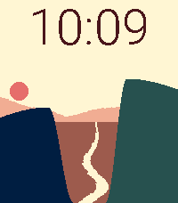
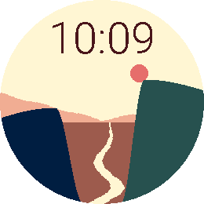
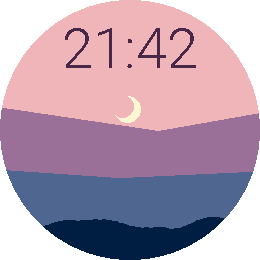

# Illustox

*A new boho-style mountain landscape every hour, every quarter or every minute.*

  

A Pebble watchface (v1.0.0) for Pebble Time 2 (emery) and Pebble Round 2 (gabbro).

Every scene is generated on the watch from a random seed: three or four layered mountain ridges (soft hills or sharp peaks), or a valley with a winding river between two mountains. A sun by day (7:00 to 18:59), a crescent moon at night. The time sits on top in Roboto Light.

## Settings

- **Colour world** - Desert, Dusk, Sage, Ocean, Sunset, Candy, or Surprise me (a random world for every scene).
- **New landscape** - every minute, every 15 minutes or every hour (default).
- **Shake for a new landscape** - a wrist flick paints a fresh scene (default on).

## How it works

- The seed is the current time slot (`time / interval`) plus a shake counter, so the scene stays stable between redraws and nothing but the seed is stored.
- Ridges are a few random control points joined by cosine (hills) or straight (peaks) segments, plus a low-frequency sine wiggle, filled column by column.
- Colour worlds live in the `WORLDS` table at the top of `src/c/illustox.c`. Pebble has 64 colours only, and gabbro shows them desaturated.

## Building

Requires the [Pebble SDK](https://developer.repebble.com/sdk/).

```bash
pebble build
pebble install --emulator gabbro
```

## Release notes

### 1.0.0

First release.

## Status

- 1.0.0 done: generator, six colour worlds, three intervals, shake, store text, screenshots. Not yet tested on a real watch.
- Ideas: more scene types (lake, dunes, stars at night), optional date.

## License

MIT, see [LICENSE](LICENSE). Roboto Light is licensed under the Apache License 2.0.
